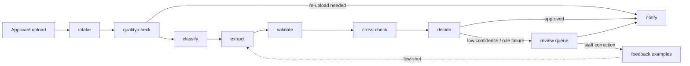

# Admission Processor

A multi-tenant, AI-assisted platform that checks university admission
documents. Python functions on OpenFaaS take uploaded documents through
quality checks, classification, field extraction, rule validation and
cross-document consistency checks. Then they either approve a file or send it
to a human reviewer. Each university is a tenant, and its requirements are
configuration rather than code.

> All data in this repository is synthetic. The universities ("University A",
> "University B", "University C") are fictional.

## Problem

Every admission season, universities in Lahore receive tens of thousands of
scanned or phone-photographed documents: CNICs or B-forms, Matric and FSc result
cards from different boards, domicile certificates, entry-test scorecards and
fee challans. Staff check them by hand against requirements that differ by
university and change every year. The work arrives in a burst before each
deadline, which leaves documents in queues and lets mistakes through. The rest
of the year the same staff and servers sit idle.

This project automates the routine checks, sends only uncertain cases to
people, and learns from their corrections. Serverless functions scale with the
deadline-night burst and down to zero afterwards.

## Architecture



- **OpenFaaS + NATS**: one function per step, chained by asynchronous
  invocations queued on NATS.
- **PostgreSQL + pgvector**: results, audit log, review queue, and the
  few-shot examples each tenant builds up from corrections.
- **S3-compatible object storage**: uploaded files under tenant-scoped keys.
- **PaddleOCR (Tesseract fallback)** for text, **Ollama** for local LLM and
  vision models. No document leaves the deployment.
- **Tenant configuration** in `tenants/`: required documents, fields,
  validation rules, thresholds, and English/Urdu notification templates.

Design decisions are recorded in [docs/adr/](docs/adr/).

## Documentation

| Document | Contents |
| --- | --- |
| [Architecture](docs/architecture.md) | Components, lifecycle and sequence diagrams, isolation, confidence |
| [Functions](docs/functions.md) | Interface and behaviour of every function |
| [Tenant configuration](docs/tenant-configuration.md) | Writing and validating a tenant file, onboarding |
| [Deployment](docs/deployment.md) | Local, faasd and k3s deployments, sizing, scaling |
| [Evaluation](docs/evaluation.md) | Measured results and what is still to be measured |
| [Security and privacy](docs/security-privacy.md) | PII handling, controls, operator responsibilities |
| [Limitations](docs/limitations.md) | Known limits and future work |
| [Contributing](CONTRIBUTING.md) | Branching, commits, tests and review |

## Repository layout

| Path | Contents |
| --- | --- |
| `functions/` | One OpenFaaS function per directory |
| `libs/common/` | Shared library: settings, tenant context, logging, storage, db, schemas |
| `tenants/` | Tenant configuration files |
| `synthetic/` | Synthetic document generator |
| `infra/` | Docker Compose, manifests, monitoring |
| `load-tests/` | k6 scripts |
| `docs/` | Architecture docs and ADRs |

## Getting started

Requires Python 3.11+ and GNU Make. Docker is optional (integration tests,
local services), and so is Tesseract (real OCR in the evaluation).

```bash
make setup                     # create .venv, install dev dependencies and git hooks
make check                     # lint + strict typecheck + unit tests (incl. end-to-end)
make synthetic APPLICATIONS=10 # generate a seeded synthetic dataset
make up && make migrate        # PostgreSQL+pgvector, SeaweedFS, Redis, NATS
make test-integration          # repositories and S3 against those services
.venv/bin/python -m synthetic.evaluation.accuracy --ocr tesseract
make help                      # list all targets
```

To deploy on OpenFaaS, see [docs/deployment.md](docs/deployment.md).

## Contributing

Work happens on short-lived branches with Conventional Commits; see
[CONTRIBUTING.md](CONTRIBUTING.md). `make check` must pass before every
commit.

## License

[MIT](LICENSE)
