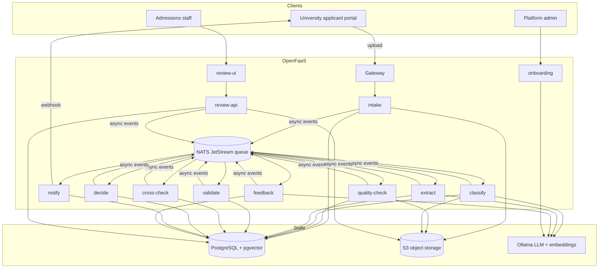
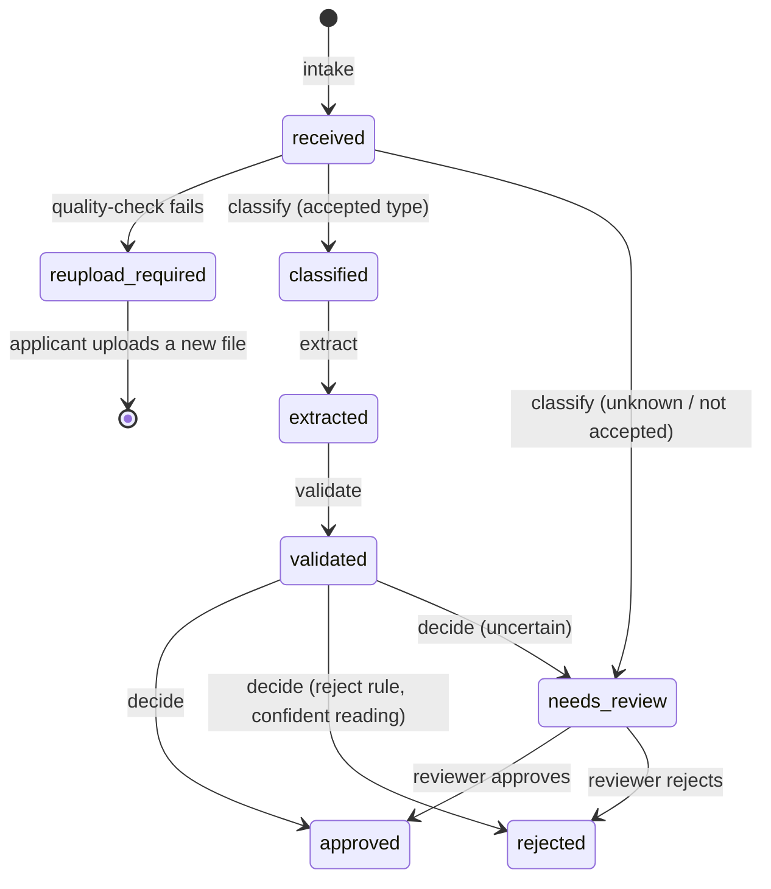
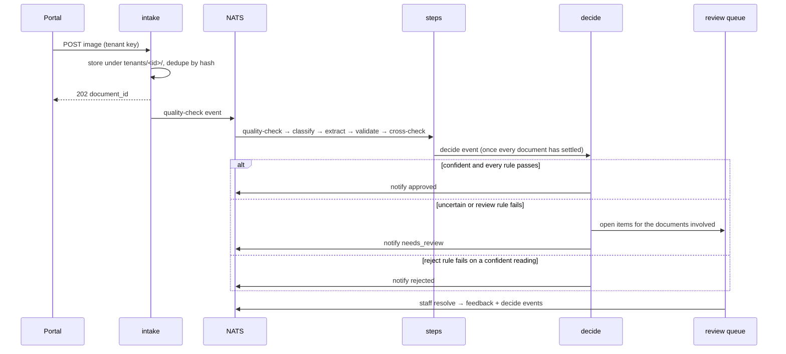

# Architecture

The platform checks university admission documents on behalf of several
universities (tenants) at once. Each pipeline step is a stateless OpenFaaS
function. Steps hand work to each other through NATS-backed asynchronous
invocations. Everything that varies between universities lives in tenant
configuration files. Decisions behind this shape are in [docs/adr](adr/).

## Components

## Document lifecycle

## Pipeline sequence

## Steps

| Step | Input | Output | Tenant config used |
| --- | --- | --- | --- |
| intake | raw file + headers | stored object, `documents` row | auth secret |
| quality-check | stored image | quality report; re-upload or continue | `quality` |
| classify | image | OCR text, document type | `decision.classification_min_confidence`, accepted types |
| extract | OCR text | typed fields with confidence | `documents[].fields`, `decision.*`, few-shot examples |
| validate | fields | rule outcomes | `rules`, field patterns |
| cross-check | all documents of an application | agreement outcomes | `cross_checks` |
| decide | all evidence | approved / needs review / rejected / incomplete | thresholds, severities |
| notify | decision | message to the portal | `notifications` |
| review-api / ui | staff actions | corrections, verdicts | staff secret, field specs |
| feedback | a corrected document | tenant few-shot example | — |
| onboarding | checklist + samples | draft config, pending approval | schema |

Per-function details are in [functions.md](functions.md).

## Tenancy and isolation

- **Identity:** the tenant ID comes from the credential the caller presents
  (upload, staff or admin key), never from a body field.
- **Storage:** every object key is built by `TenantStorage` under
  `tenants/<tenant_id>/`; reading another tenant's key is refused.
- **Database:** every statement goes through `Database`, which refuses SQL
  that does not filter on `%(tenant_id)s`.
- **Learning:** few-shot examples are retrieved only within the same tenant
  and document type.
- **Logs:** every line carries `tenant_id`, `document_id` and a correlation
  ID; identifiers and names are masked.

## Confidence and decisions

Field confidence starts from OCR line confidence. It is lowered when a value
fails its type or pattern, raised when the caption reader and the LLM agree,
and lowered when they disagree. A document's confidence is its weakest field.
The decide step compares it with the tenant's `auto_approve_min_confidence`.
Reject-severity rules only reject when the value was read confidently;
otherwise the document goes to review.

## Idempotency

Each effect has its own idempotency key; see
[ADR 0006](adr/0006-idempotent-steps.md). Redelivered events and repeated
uploads change no stored state and send no duplicate notifications. The
end-to-end test checks this.
